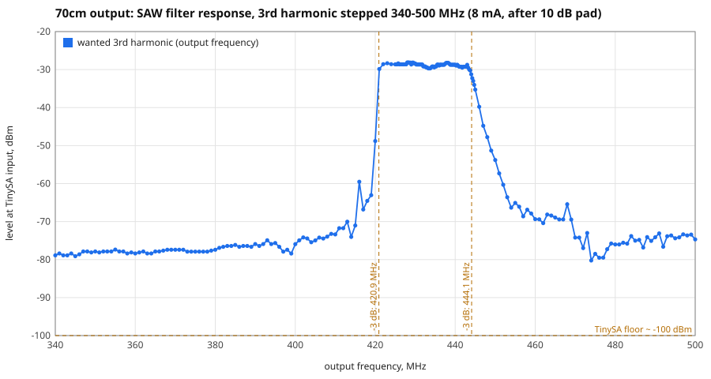
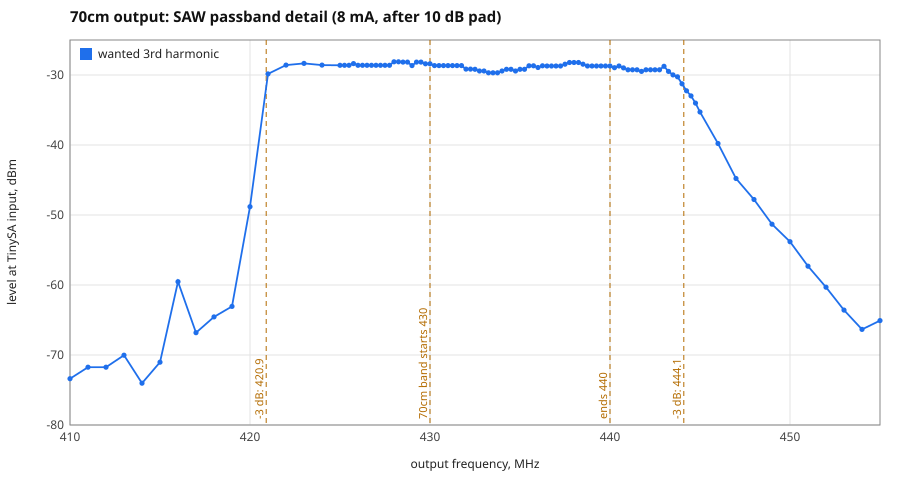
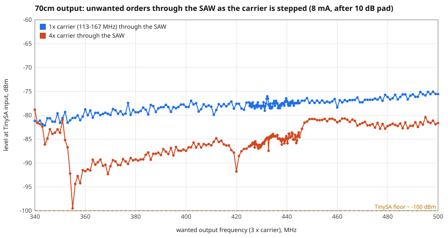
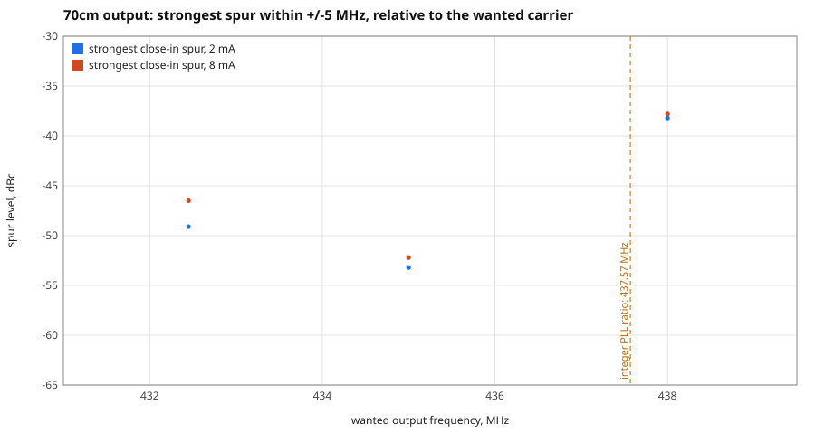
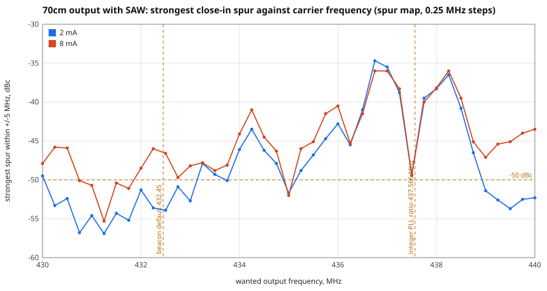

# 70cm output characterisation (CLK2, 3rd harmonic, with SAW filter)

> **Second correction (pad value).** This document assumed the attenuator in front of the analyser was exactly 10 dB.
> **It is not: it loses 25.8 dB at 435 MHz** (25.0 to 26.2 dB at 420-450 MHz), measured later the same day by comparing
> CLK2 through a straight cable with CLK2 through the attenuator. (The same part loses 27 dB at 20-180 MHz; see the 6m
> document.) So every **absolute level "leaving the SAW"** below was 15.8 dB too low, and the **PGA-103+ prediction in
> section 5 changes materially**: the amplifier would be driven to +13 to +18 dBm, not -3 to +3 dBm, much closer to its
> P1dB. Everything in dBc, the SAW shape, the spur offsets and the out-of-band signals is unchanged, because those are
> ratios of readings taken through the same pad. Levels "at the TinySA" are the raw readings and are unchanged. The
> converted figures carry an uncertainty of about 3 dB, because the pad was measured without the SAW in front of it and the
> two do not match perfectly.

> **Correction (later the same day).** The first version of this document said that, apart from the 145 MHz carrier and
> the 580 MHz 4th harmonic, nothing out of band was visible above the floor. **That was wrong.** The first campaign's
> peak finder never looked at the first and last point of each scan window, and the 5th harmonic of the carrier, at
> **725.0 MHz**, falls exactly on a window's first point. The bench framework joins its windows into one trace and found
> it: it is at -33 to -37 dBc, the **strongest out-of-band emission through the SAW**. It is a real signal (see section 3).
> The affected figures below have been corrected.

Measured 2026-10-31 (01:35-01:48), firmware at commit `7859547`.
Raw data: [`data/70cm-saw-2026-10-31.json`](data/70cm-saw-2026-10-31.json).
This was a one-off, hand-run campaign (script: [`../tests/bench/campaign_70cm_v0.py`](../tests/bench/campaign_70cm_v0.py)).
The measurements are now repeatable with the bench framework in [`../tests/bench/`](../tests/bench/README.md), and this
run's data has been imported into `tests-results/` so it can be compared with later runs in the bench web UI.

## Summary

| | Result |
|---|---|
| SAW passband (-3 dB) | **420.9 to 444.1 MHz** (23.2 MHz wide, centred on 432.5 MHz) |
| Passband flatness | about 1.6 dB p-p (-29.7 to -28.1 dBm) over 421-443 MHz; the whole 430-440 MHz band is inside it |
| SAW rejection | 42 to 50 dB below 415 MHz; 25 dB at 450 MHz; 36 dB at 455 MHz; 45 to 47 dB above 470 MHz |
| Wanted level leaving the SAW | about **-8.9 dBm (2 mA) to -3.4 dBm (8 mA)** at 435 MHz (about +/-3 dB; the first version said -24.7 to -19.2 dBm, using a 10 dB pad) |
| Strongest out-of-band signals, 5-800 MHz | **725 MHz (5th harmonic of the carrier) at -33 dBc (2 mA) / -36 dBc (8 mA)**; 145 MHz carrier at -47 to -52 dBc; 580 MHz (4th harmonic) at -53 to -54 dBc. Everything else is below the analyser's floor (about -54 dBc or lower) |
| Close-in spurs (within 5 MHz) | **depend strongly on the carrier frequency**: across 430-440 MHz the strongest spur ranges from **-57 dBc (best, 431.25 MHz) to -35 dBc (worst, 436.75 MHz)**; see the spur map below |
| Through a PGA-103+ (datasheet gain) | about **+13 to +18 dBm** out (20-69 mW); the 8 mA case is within about 3 dB of its +21.5 dBm P1dB |

The close-in spurs are the main concern: the SAW is wide, so it cannot remove them, and their level changes by
over 20 dB across the band. The spur map (section 2) shows where they are and why.

## Setup

```
Pico W --I2C-- Si5351 (Adafruit, 25 MHz crystal, +151.3 ppm correction applied)
                 CLK2 --> SAW filter (part number unknown) --> attenuator (marked 10 dB, really 25.8 dB at 435 MHz) --> TinySA Ultra, low input
```

* CLK2 is on PLLB, MultiSynth divide 6. The carrier is 1/3 of the wanted frequency (about 145 MHz for 435 MHz); the
  wanted signal is its 3rd harmonic. Only CLK2 was enabled.
* TinySA Ultra `tinySA4_v1.4-200` (HW V0.4.6), controlled over USB. Attenuation fixed at 0 dB, LNA off.
* All levels below are **at the TinySA input, after the attenuator**. Add **25.8 dB** for the level leaving the SAW
  (the attenuator's measured loss at 435 MHz; about +/-3 dB because the SAW and the pad are not perfectly matched).
* Drive: 8 mA for the SAW sweeps; 2, 4, 6 and 8 mA where stated.

## Method

1. **SAW response.** The carrier was stepped so that the wanted 3rd harmonic moved across 340-500 MHz (0.25 MHz steps over
   425-445 MHz, 1 MHz steps elsewhere). At each step the level was read at 1x, 2x, 3x and 4x the carrier (2 scans of a
   +/-150 kHz window, 41 points, RBW 10 kHz, averaged; the peak was taken).
2. **Close-in spectrum.** +/-5 MHz around the wanted signal, RBW 30 kHz, 401 points (25 kHz steps, so the step is smaller
   than the RBW), 6 sweeps averaged. Peaks within 150 kHz of the carrier are ignored: they are the analyser's own filter
   skirt (their level changes with RBW; checked at 30, 10 and 3 kHz).
3. **Wide spectrum.** 5-800 MHz in 18 windows of 450 points, RBW 100 kHz (100 kHz steps), 2 sweeps averaged. Floor about
   -102 dBm; peaks more than 12 dB above the floor were listed. With RBW equal to the step a narrow peak can read up to
   about 3 dB low.
4. **Level against drive** at 435 MHz.

Repeatability of the same sweep on the same setup was about 0.5 dB. The TinySA is not a calibrated instrument: use the
**relative** numbers (dB, dBc) with more confidence than the absolute dBm.

## 1. SAW filter





Passband reference (median over 421-443 MHz): -28.7 dBm at the TinySA. Edges, by interpolation:

| Level below passband | Lower edge, MHz | Upper edge, MHz | Width, MHz |
|---|---|---|---|
| 3 dB | 420.9 | 444.1 | 23.2 |
| 10 dB | 420.5 | 445.8 | 25.2 |
| 20 dB | 420.0 | 448.3 | 28.3 |
| 30 dB | 419.3 | 451.5 | 32.2 |
| 40 dB | 415.2 | 459.5 | 44.3 |

The lower edge is very steep (20 dB between 420 and 421 MHz) and was sampled at 1 MHz steps only, so the lower-edge figures
are good to about +/-0.5 MHz. The upper edge is much gentler.

Rejection (dB below the passband):

| Frequency, MHz | 340 | 360 | 380 | 400 | 410 | 415 | 420 | 445 | 447 | 450 | 455 | 460 | 470 | 480 | 500 |
|---|---|---|---|---|---|---|---|---|---|---|---|---|---|---|---|
| Rejection, dB | 50 | 50 | 49 | 47 | 45 | 42 | 20 | 7 | 16 | 25 | 36 | 41 | 46 | 47 | 46 |

* There is a narrow bump at about **416 MHz** (only 31 dB of rejection) and a smaller one near 468 MHz: typical SAW
  out-of-band responses.
* Insertion loss is **not known**. A comparison with an earlier unfiltered reading suggests it is small, but that reading
  used a stepped sweep and is not reliable. Measuring 435 MHz with the SAW bypassed, same setup, would settle it.
* This measures the SAW together with the source (the Si5351's 3rd-harmonic amplitude, assumed smooth with frequency).

Other orders of the carrier through the SAW, 8 mA:



* 1x carrier (113-167 MHz): about -78 dBm (-82 to -75), i.e. about -49 dBc against the wanted signal.
* 2x carrier: at or below the analyser floor (about -95 dBm).
* 4x carrier at 435 MHz: -84.4 dBm, i.e. about -56 dBc.

## 2. Close-in spurs



Strongest spurs within +/-5 MHz (offset from the wanted signal in MHz, level in dBc):

| Wanted, MHz | Drive | Carrier at TinySA | Strongest spurs |
|---|---|---|---|
| 435.00 | 2 mA | -34.1 dBm | +/-0.65: -53; +/-1.50: -57; +/-0.33: -57 |
| 435.00 | 4 mA | -31.7 dBm | +/-0.65: -53; +/-1.48: -55 |
| 435.00 | 6 mA | -32.2 dBm | +/-0.65: -53; +/-1.4 to 1.6: -57 |
| 435.00 | 8 mA | -29.8 dBm | +/-0.65: -52; 0.33: -57 |
| 432.45 | 2 mA | -34.1 dBm | -1.15: -49; -1.32: -52; 1.52: -54 |
| 432.45 | 8 mA | -29.9 dBm | +/-1.50: -47; -1.32: -48; -1.15: -49 |
| 438.00 | 2 mA | -31.6 dBm | **+/-0.88: -38**; 4.03: -58 |
| 438.00 | 8 mA | -28.9 dBm | **+/-0.88: -38**; 4.03: -50; 0.62: -55 |

* The spur pattern and level **change a great deal with the carrier frequency**, and barely with drive. At 438 MHz the
  spurs at +/-0.88 MHz are 14 dB worse than at 435 MHz. This is the SAW being irrelevant: all of these are well inside its
  passband.
* The cause is almost certainly the PLL's fractional divider (VCO = 6 x carrier = 2 x the wanted frequency; the multiplier
  is 34.79 at 435 MHz, 34.59 at 432.45 MHz and 35.03 at 438 MHz). A simple model (spurs where a multiple of the
  fractional part lands near a whole number) predicts the +/-0.88 MHz spur at 438 MHz (twice the 0.43 MHz distance from
  the integer-ratio frequency 437.57 MHz) and the +/-0.65 MHz spur at 435 MHz, but does not account for all the spurs
  seen at 432.45 MHz. Treat it as a guide, not an explanation.
* PLLA against PLLB made only a 3-4 dB difference at 435 MHz in an earlier test. See PLAN.md.
* The beacon's default 70cm frequency (432.45 MHz) has spurs of about -47 to -49 dBc.

### Spur map

The bench framework (`tests/bench`, run `2026-10-31T02-28-15__70cm-saw-unknown-10dB`) measured the whole +/-5 MHz spectrum at
every 0.25 MHz from 430 to 440 MHz, at 2 mA and 8 mA (3 sweeps averaged, RBW 30 kHz, 25 kHz steps). The strongest spur at
each frequency:



| | 2 mA | 8 mA |
|---|---|---|
| Worst across the band | -34.7 dBc at 436.75 MHz | -36.0 dBc at 436.75 MHz |
| Median | -49.4 dBc | -45.8 dBc |
| Best | -56.9 dBc at 431.25 MHz | -55.3 dBc at 431.25 MHz |
| Frequencies with the strongest spur at or below -50 dBc | 19 of 41 | 6 of 41 |

* **Two regions are bad.** From about 436 to 438.5 MHz the strongest spur is -35 to -43 dBc, and there is a smaller peak near
  434.25 MHz (-41 to -44 dBc). The cleanest region is 430.75 to 432 MHz and around 435.0 MHz.
* **Lower drive is cleaner** (relative to the wanted signal) over most of the band: typically 4 to 9 dB better at 2 mA than at
  8 mA between 430 and 433 MHz and above 439 MHz. In the worst region (436 to 438.5 MHz) the two are within about 1 dB, and
  8 mA is very slightly better at 436.75 MHz. In absolute terms the spurs are lower at 2 mA by more than the 5 dB difference in
  the wanted level (for example at 432.5 MHz: -88 dBm at 2 mA against -76 dBm at 8 mA, at the analyser).
* **The beacon's default 432.45 MHz** is at -53 dBc (2 mA) but -46 to -47 dBc (8 mA).

**Why: fractional-N spurs.** The carrier at 145 MHz comes from a PLL running at 6 x the carrier (870 MHz). Its multiplier is
the crystal's 25.004 MHz multiplied by 34.8, a fractional number, and a fractional divider generates spurs. The pattern is
predictable: with the VCO at exactly 35 x the crystal (an integer ratio) there should be no fractional-N spurs, and that
happens at a wanted frequency of 437.566 MHz. Near that frequency the strongest spur is at **exactly twice the distance from it**:

| Wanted, MHz | Distance from 437.566 | Predicted spur offset (2 x distance) | Measured strongest spur |
|---|---|---|---|
| 436.75 | 0.82 | 1.63 | +/-1.625 MHz at -36 dBc |
| 437.00 | 0.57 | 1.13 | +/-1.125 MHz at -36 dBc |
| 437.25 | 0.32 | 0.63 | +/-0.625 MHz at -38 dBc |
| 437.75 | 0.18 | 0.37 | +/-0.375 MHz at -40 dBc |
| 438.00 | 0.43 | 0.87 | +/-0.875 MHz at -38 dBc |
| 438.25 | 0.68 | 1.37 | +/-1.375 MHz at -36 dBc |
| 438.50 | 0.93 | 1.87 | +/-1.875 MHz at -39 dBc |

At 437.50 MHz, 0.07 MHz from the integer ratio, the strong spurs disappear (-49 dBc), as the model says they should. A weaker
spur at +/-4.2 MHz (-50 dBc) is present at every frequency and moves slowly with the carrier; it is probably a different
mechanism. The raised spurs near 436 and 434.25 MHz are probably the same effect at other simple fractions of the multiplier (the fraction is
about 7/8 near 436 MHz), but that has not been checked.

**What can be done about it:**
1. Choose the beacon frequency with the map: 431.25 MHz (-55 to -57 dBc) is the cleanest; 435.0 MHz is good (-52 dBc).
   Anywhere between 436 and 438.5 MHz is poor.
2. Prefer a lower drive, and recover the power in the amplifier.
3. The default 432.45 MHz segment frequency is acceptable at 2 mA and is the first thing to re-check at 8 mA.
4. A frequency near an integer PLL ratio (437.50 MHz here) is a good choice where it is allowed: the nearby strong spurs vanish.
   The same idea applies to every band: the cleanest frequencies are those whose VCO is close to a whole multiple of the crystal.
5. The ppm correction moves the integer-ratio frequency (the crystal is 151 ppm fast), so the clean frequency must be
   recomputed if the crystal's calibration changes.

## 3. Out-of-band emissions (5-800 MHz)

Three signals, other than the wanted one and its close-in family, rise more than 12 dB above the floor:

| Signal | 2 mA | 8 mA |
|---|---|---|
| **725.0 MHz (5x carrier)** | **-33 dBc** (-67.4 dBm at the analyser) | **-36 dBc** (-66.4 dBm) |
| 145.0 MHz (carrier fundamental, inside the 2m band) | -51 dBc | -47 dBc |
| 580.0 MHz (4x carrier) | -53 dBc | -54 dBc |

Everything else from 5 to 800 MHz is below about -90 dBm, i.e. at least 54 dB below the wanted signal. The 2nd harmonic of the
carrier (290 MHz) is not visible. The TinySA's low input stops at 800 MHz, so the 870 MHz signal (2 x 435 MHz, the VCO
frequency) and everything above is **not covered**.

**The 725 MHz signal is real, not an analyser artefact.** With the Si5351 output off there is nothing at 725 MHz (only noise at
-95 to -108 dBm). The TinySA corrects its readings back to its input, so a real signal reads the same whatever attenuation
the analyser itself adds, while a spur the analyser creates from the strong wanted signal falls as that attenuation is
raised. At 8 mA with 0, 10 and 20 dB of analyser attenuation the readings were:

| Analyser attenuation | 145 MHz | 435 MHz (wanted) | 580 MHz | 725 MHz |
|---|---|---|---|---|
| 0 dB | -77.5 | -29.2 | -83.9 | **-66.0** |
| 10 dB | -77.0 | -29.2 | -85.9 | **-66.0** |
| 20 dB | -77.5 | -29.7 | -83.9 | **-66.0** |

Every signal, 725 MHz included, stays where it is. (The wide-spectrum test now repeats this check automatically for the
strongest out-of-band signals it finds, and marks each one "real signal" or "made by the analyser".)

**Why it is so strong:** the carrier is a square wave, whose 5th harmonic is only 4.4 dB below the 3rd (the wanted signal),
and this SAW does little to stop it. The response test (procedure v2, run `2026-10-31T02-51-44`) reads the 5th order as the
wanted frequency is stepped, which traces what the SAW does to the carrier's 5th harmonic from 567 to 790 MHz (wanted
frequencies 340-474 MHz). At 8 mA, as read at the analyser:

| Wanted frequency, MHz | 5x carrier, MHz | 5th harmonic, dBm | Relative to the wanted signal |
|---|---|---|---|
| 425 | 708 | -67.4 | -39 dBc |
| 430 | 717 | -67.7 | -39 dBc |
| 435 | 725 | -66.2 | -37 dBc |
| 440 | 733 | -66.8 | -38 dBc |
| 445 | 742 | -69.8 | -35 dBc (the wanted signal is already falling) |

* Across the whole 70cm band the 5th harmonic is **-37 to -40 dBc** (worst at 436.25 MHz).
* It is **flat at about -67 dBm (-65 to -70)** wherever it falls between 567 and 790 MHz. The SAW does not discriminate in this
  range, so there is no "bad frequency" to avoid: it is a general weakness of the filter at these frequencies.
* Taking the 5th harmonic as 4.4 dB below the 3rd at the source (ideal square wave), the SAW attenuates it by only about 34 dB,
  against 46-50 dB for the 340-500 MHz range of section 1. That is an estimate; the source's harmonic ratio was not measured.

## 4. Level against drive (435 MHz)

| Drive | Wanted at TinySA | Wanted leaving the SAW (+25.8 dB) | 145 MHz fundamental at TinySA | 145 MHz relative to wanted |
|---|---|---|---|---|
| 2 mA | -34.7 dBm | -8.9 dBm | -86.5 dBm | -52 dBc |
| 4 mA | -32.2 dBm | -6.4 dBm | -81.0 dBm | -49 dBc |
| 6 mA | -32.7 dBm | -6.9 dBm | -78.5 dBm | -46 dBc |
| 8 mA | -29.2 dBm | -3.4 dBm | -77.0 dBm | -48 dBc |

The wanted 3rd harmonic is **not monotonic** with drive (6 mA is lower than 4 mA), unlike the fundamental on 6m. Between
repeats at the same setting the carrier moved by about 0.5 dB (8 mA: -29.2, -29.8, -29.9 dBm).

## 5. Baseline for a PGA-103+ stage

PGA-103+ datasheet (Mini-Circuits, Rev C, 5 V supply), gain interpolated between the tabulated points:

| | 145 MHz | 435 MHz | 580 MHz | 725 MHz |
|---|---|---|---|---|
| Gain, dB (interpolated) | 25.3 | 21.8 | 20.3 | 18.9 |

Other datasheet figures at 400 MHz: P1dB +21.5 dBm, OIP3 +39 dBm, noise figure 0.5 dB, input return loss 11.3 dB. Absolute
maximum input +21 dBm CW. Gain is specified at -25 dBm input. Supply 5.0 V (4.8-5.2 V), 97 mA typical, with an input
DC block and an RF-choke bias tee on the output (datasheet Fig. 2a/2b).

Predicted at the amplifier output, assuming the amplifier is linear. This is **less safe than the first version said**: the
8 mA output is within about 3 dB of the P1dB, so expect a little compression and extra harmonics from the amplifier itself
(the input, -3 dBm, is still 24 dB below its +21 dBm maximum):

| Drive | Into the PGA | Out at 435 MHz | 145 MHz spur | 580 MHz spur | **725 MHz spur** | Worst close-in spur at 435 MHz |
|---|---|---|---|---|---|---|
| 2 mA | -8.9 dBm | **+12.9 dBm** | -48 dBc | -55 dBc | **-36 dBc** | -53 dBc |
| 8 mA | -3.4 dBm | **+18.4 dBm** | -44 dBc | -56 dBc | **-39 dBc** | -52 dBc |

* The fundamental gets **worse** by 3.5 dB relative to the wanted signal because the amplifier has more gain at 145 MHz;
  the 4th and 5th harmonics get 1.5 and 2.9 dB better. The close-in spurs are unchanged.
* At 8 mA the 725 MHz signal would be about -22 dBm at the amplifier output, 40 dB below the wanted signal: that is the
  strongest unwanted signal outside the band, and it needs filtering.
* The output would be about 20 mW (2 mA) to 69 mW (8 mA). At 8 mA that is only about 3 dB below the amplifier's P1dB, so
  it is probably better to run at 4 or 6 mA, or to put a few dB of pad in front of the amplifier. The amplifier's own
  harmonic output is not specified in the datasheet and should be measured.
* The PGA-103+ is a wideband amplifier: it will amplify the 145 MHz leak, the 580 MHz harmonic and the close-in spurs along
  with the wanted signal. Any extra filtering is best placed *before* it for the 145 MHz leak and *after* it for harmonics.

## 6. What this suggests

1. **Choose the 70cm frequency with the close-in spurs in mind.** A "spur map" (strongest spur against carrier frequency over
   430-440 MHz in small steps) would show which frequencies are clean. This is a software-only test.
2. **The SAW does not help with spurs near the carrier**, nor much with the 145 MHz leak (about 50 dB), and it is weak near
   725 MHz. A high-pass in front of the SAW would help the 145 MHz leak.
3. **A low-pass filter is now the most important addition.** The 725 MHz 5th harmonic (-33 to -37 dBc) and the 580 MHz 4th
   harmonic (-53 dBc) both need to go: a low-pass with a cutoff of about 470 MHz, with enough rejection at 580 and 725 MHz,
   placed after the SAW (and after the amplifier too, to catch the amplifier's own harmonics).
4. Decide what spurious limit applies to the beacon before judging these numbers; they are in dBc relative to the
   wanted signal, not absolute.

## 7. With a 12 cm pigtail before the SAW (2026-11-01)

The chain was measured again with a 12 cm pigtail between the Si5351 board and the SAW, to see if moving the filter away from the
board reduces high-frequency coupling (it appeared to on 2m). The first attempt was refused by the runner: the signal at the
analyser was -23.2 dBm at 8 mA, 6 dB higher than the baseline and over the -25 dBm limit. A series of short checks found out why
(drive 2 to 8 mA, 435 MHz, analyser internal attenuation 10 to 20 dB so the front end was not overloaded):

| Chain | 2 mA | 4 mA | 6 mA | 8 mA |
|---|---|---|---|---|
| Straight cable, no pigtail, no SAW (at 435 MHz, 2 mA only) | -9.2 dBm | | | |
| Pigtail, no SAW (same, 2 mA only) | -9.5 dBm | | | |
| Pigtail, "10 dB" attenuator, no SAW | -35.2 | -28.7 | -27.0 | -23.2 |
| SAW directly on the board, attenuator (reproduces the baseline) | -34.7 | -32.0 | -32.5 | -29.5 |
| Pigtail, SAW, attenuator | **-28.9** | **-24.2** | **-22.9** | **-22.7** |
| Pigtail, SAW, T pad, attenuator | -38.7 | -34.2 | -32.7 | -32.7 |

(Analyser readings, after the attenuator and any T pad.)

* **The pigtail alone costs 0.3 dB** (-9.2 to -9.5 dBm at 435 MHz, flat to +/-0.2 dB from 425 to 445 MHz), so the cable is not the
  loss. The "10 dB" attenuator loses 25.5 dB at 435 MHz here (25.8 in the baseline), flat from 425 to 445 MHz.
* **With the SAW in line, the pigtail raises the 435 MHz output by 5.8, 7.8, 9.7 and 6.8 dB** at 2, 4, 6 and 8 mA compared
  with the SAW directly on the board. At 2 to 6 mA the result is also 4 to 6 dB higher than with no SAW at all. A SAW cannot add
  level, so this is an effect on the source. The idea that fits is that the SAW reflects the fundamental and the other harmonics
  that are outside its pass band, and with a 12 cm line in between, what comes back reshapes the Si5351's output and
  strengthens the 3rd harmonic. **This is a hypothesis, not a measurement.** What is measured is that the level depends on the
  line between the board and the SAW. A different length would probably give a different level.
* **The baseline's non-monotonic drive curve** (6 mA lower than 4 mA) is reproduced with the SAW directly on the board, so it is
  a feature of that zero-length connection. With the pigtail the level rises to 6 mA and then stops: 6 and 8 mA are the same.
* **The T pad loses only 9.9 dB at 435 MHz** (9.84 to 10.0 dB at all four drives, measured in place), not the 15 dB it has at
  145 MHz: the carbon resistors are not flat to UHF. The total pad for this run is therefore 25.8 + 9.9 = **35.7 dB** (about
  +/-0.3 dB, as the attenuator reads 25.5 to 25.8 dB). The pad is recorded in setup `70cm-saw-unknown-tpad-10dB-12cm-pigtail`.

Full suite with the T pad added: run
[`../tests-results/70cm/2026-11-01T20-08-05__70cm-saw-unknown-tpad-10dB-12cm-pigtail.json`](../tests-results/70cm/2026-11-01T20-08-05__70cm-saw-unknown-tpad-10dB-12cm-pigtail.json).
The 8 mA level at the analyser was -32.7 dBm (limit -25).

| | Baseline | Pigtail + T pad |
|---|---|---|
| Total pad | 25.8 dB | 35.7 dB |
| Wanted leaving the SAW, 2 / 4 / 6 / 8 mA | -8.6 / -6.4 / -6.9 / -3.1 dBm | -2.2 / +2.0 / +3.0 / +3.0 dBm |
| Worst close-in spur at 435 MHz, 8 mA | -52.9 dBc | -52.3 dBc |
| Worst close-in spur at 432.45 MHz, 2 / 8 mA | -49.7 / -46.1 dBc | -48.4 / -41.6 dBc |
| Worst close-in spur at 438 MHz, 2 / 8 mA | -38.5 / -38.1 dBc | -37.1 / -39.0 dBc |
| Spur map median, 2 / 8 mA | -48.9 / -45.4 dBc | -51.3 / -46.4 dBc |
| Worst spur on the map | -34.8 dBc (436.75 MHz, 2 mA); -35.8 dBc (437.0 MHz, 8 mA) | -33.8 dBc (438.25 MHz, 2 mA); -36.0 dBc (438.25 MHz, 8 mA) |
| Best spur on the map, 2 / 8 mA | -56.6 / -56.1 dBc (431.25 MHz) | -56.9 (434.75 MHz) / -55.8 dBc (431.25 MHz) |
| 5th harmonic, 725 MHz, 2 mA | -32.8 dBc | not reported |
| 5th harmonic, 725 MHz, 8 mA | -36.3 dBc | -46.5 dBc |
| 145 MHz leak, 8 mA / 580 MHz, 8 mA | -47.3 / -53.7 dBc | not reported |
| SAW -3 dB points | 420.9 to 444.1 MHz | 421.6 to 444.7 MHz |
| Passband ripple | 1.6 dB | 3.5 dB |

* **The close-in spurs are unchanged** apart from a 4.5 dB worse figure at 432.45 MHz and 8 mA. The clean region is still about
  431 to 432 MHz and the bad region 436 to 438.5 MHz.
* **The 5th harmonic at 725 MHz is 10 dB better in dBc at 8 mA** (at least 18 dB at 2 mA, where it fell below the detection
  limit). How much of this is the 6 dB higher wanted level cannot be told, because the raw 725 MHz level and the T pad's loss at
  725 MHz were not measured. The 145 MHz leak and 580 MHz entries also fell below the threshold.
* **The ripple and rejection figures are less reliable than the baseline's.** The extra 10 dB of pad leaves less range above
  the analyser's noise floor (so the measured rejection, 18.7 dB high side against 24.8, is partly floor-limited), and the
  ripple may include a real effect of the line.
* **For a PGA-103+ stage** (gain about 21.8 dB at 435 MHz, P1dB +21.5 dBm): with the pigtail the SAW output at 2 mA is -2.2 dBm,
  which gives about +19.6 dBm (91 mW) from the amplifier, below its compression point. At 4 mA and above the SAW output is +2
  to +3 dBm, which would put the amplifier at +24 to +25 dBm, past P1dB, so a higher drive would need attenuation ahead of it. The
  figures in section 5 apply to the baseline connection only.
* **Without a pad at the source, the line length between the board and the SAW is a design parameter** for 70cm (see the next subsection). A few lengths (for example 6, 12
  and 18 cm) would show if the effect varies with length. That has not been done.

### A pad at the source removes the dependence on line length (2026-11-01)

The 6 to 10 dB rise could be explained by reflections from the SAW getting back to the Si5351 through the pigtail. A pad directly at
the output should stop that: a reflection passes through the pad twice, so a pad of X dB cuts it by 2X dB, and the source sees a
steady load. To test this, the carbon T pad (9.9 dB at 435 MHz) was fitted **directly at the CLK2 output, ahead of the SAW**,
and the same four drives were measured with and without the 12 cm pigtail between the pad and the SAW (analyser readings,
after the SAW and the "10 dB" attenuator):

| Chain | 2 mA | 4 mA | 6 mA | 8 mA |
|---|---|---|---|---|
| T pad, SAW (F1) | -47.4 dBm | -41.7 | -38.2 | -36.2 |
| T pad, 12 cm pigtail, SAW (F2) | -48.9 | -43.0 | -39.7 | -37.2 |
| Pigtail effect (F2 minus F1) | **-1.5 dB** | **-1.3** | **-1.5** | **-1.0** |
| For comparison, without the pad: pigtail effect | +5.8 | +7.8 | +9.7 | +6.8 |

* With the pad at the source, **the pigtail changes the level by only -1.0 to -1.5 dB** (a little loss, as the pigtail alone costs
  0.3 dB; the remainder is probably a small mismatch), instead of raising it by 6 to 10 dB.
* The pad also makes the SAW behave as a fixed-loss element. Compared with the straight pigtail and no SAW (C1 above), the T pad
  plus SAW loses 11.2 to 13.0 dB at the four drives (about 12.4 dB: the pad's 9.9 dB plus roughly 2.5 dB for the SAW), and the
  drive curve rises smoothly with no dip at 6 mA. Without the pad, the SAW's apparent effect varied with drive from +0.5 to
  -6 dB.
* This fits the reflection explanation. It is **not a direct measurement of the reflection**, but it is the result expected if
  reflections were the cause.
* **Design consequence:** a pad at the Si5351 output (a proper SMA attenuator of 6 dB or more, rated well above 435 MHz, since the
  carbon T pad is not flat at UHF) should make the output level and spurs repeatable whatever filter and cable follow it. It
  costs level that a PGA-103+ stage could not use anyway. The same reasoning applies to 6m and 2m, but it was only tested on 70cm.

**Full suite with the pad at the source.** Run
[`../tests-results/70cm/2026-11-01T20-41-48__70cm-tpad-12cm-pigtail-saw-unknown-10dB.json`](../tests-results/70cm/2026-11-01T20-41-48__70cm-tpad-12cm-pigtail-saw-unknown-10dB.json),
setup `70cm-tpad-12cm-pigtail-saw-unknown-10dB`: CLK2, the T pad (9.9 dB), the 12 cm pigtail, the SAW, the "10 dB" attenuator
(25.8 dB), the analyser. `pad_db` is 25.8, so the levels are "leaving the SAW" as in the baseline, but they include the T pad's
loss, so they read about 12 dB lower than the baseline's. The 8 mA level at the analyser was -37.2 dBm (limit -25).

| | Baseline (SAW on the board) | Pigtail, T pad after the SAW | **T pad at the source, pigtail, SAW** |
|---|---|---|---|
| Wanted leaving the SAW, 2 / 4 / 6 / 8 mA | -8.6 / -6.4 / -6.9 / -3.1 dBm | -2.2 / +2.0 / +3.0 / +3.0 | -23.4 / -17.4 / -13.4 / -11.1 (includes the T pad) |
| Drive curve | dips at 6 mA | flat from 6 to 8 mA | smooth, rising |
| SAW -3 dB points | 420.9 to 444.1 MHz | 421.6 to 444.7 | **420.9 to 444.2** |
| Passband ripple | 1.6 dB | 3.5 dB | **1.6 dB** |
| Rejection, low / high side | 41.3 / 24.8 dB | 35.9 / 18.7 | **43.3 / 24.6** |
| Worst close-in spur at 435 MHz, 4 / 6 / 8 mA | -52.8 / -52.8 / -52.9 dBc | -53.5 / -53.1 / -52.3 | -52.7 / -53.3 / -51.1 |
| Worst close-in spur at 432.45 MHz, 8 mA | -46.1 dBc | -41.6 | -47.1 |
| Worst close-in spur at 438 MHz, 2 / 8 mA | -38.5 / -38.1 dBc | -37.1 / -39.0 | -38.9 / -35.8 |
| Spur map median, 8 mA | -45.4 dBc | -46.4 | -45.1 |
| Spur map worst / best, 8 mA | -35.8 (437.0 MHz) / -56.1 (431.25 MHz) | -36.0 (438.25) / -55.8 (431.25) | **-31.2 (440.0 MHz)** / -55.1 (431.25 MHz) |
| 725 MHz, 8 mA | -36.3 dBc | -46.5 | -39.8 |
| 580 MHz, 8 mA | -53.7 dBc | not reported | -50.5 |

* **The SAW response is back to the baseline's** (same -3 dB points, same 1.6 dB ripple, same rejection to within 2 dB). So the
  worse ripple and rejection in the unpadded pigtail run were a real effect of the line on the source, not just a loss of
  analyser range. This is the strongest single piece of support for the reflection explanation.
* **The close-in spurs match the baseline** at 435 and 432.45 MHz; the 4.5 dB loss at 432.45 MHz in the unpadded pigtail run is
  gone. The worst point on the 8 mA map moved to 440.0 MHz (-31.2 dBc), 4.6 dB worse than the baseline's worst; I have not
  compared that one frequency across the runs, so I cannot say if it is a real change.
* **The 725 MHz harmonic is -39.8 dBc**: 3.5 dB better than the baseline but 6.7 dB worse than the unpadded pigtail run. A large part
  of that run's 10 dB improvement was therefore probably just the 6 to 10 dB higher wanted level, not less 725 MHz.
* **The 2 mA data is range-limited.** With the pad at the source the 2 mA wanted signal is only -49 dBm at the analyser, so no
  close-in spur could be measured at 432.45 or 435 MHz at that drive (shown as none), and the 2 mA spur map's median and best figures
  mostly reflect the noise floor. Use the 4 to 8 mA figures; a repeat with less pad after the SAW would restore the range.
* **For a PGA-103+ stage** this connection gives -11.1 dBm at 8 mA leaving the SAW (with the T pad's 9.9 dB), so about +10.7 dBm
  out. A 6 dB pad at the source in place of the T pad would give about 4 dB more.

## 8. Screened board with a pad on the output (2026-11-03)

The Si5351 board was then screened and a screened pad (8.9 dB at 435 MHz) fitted on CLK2, with the SAW directly after it. Two
runs, unfiltered and with the SAW (`pad_db` 25.8, so the levels leaving the SAW include the pad's loss). Full write-up in
[`screened-topology.md`](screened-topology.md).

| | Screened pad + SAW | Baseline (no source pad) |
|---|---|---|
| 435 MHz at the analyser, 2 / 4 / 6 / 8 mA | -45.7 / -39.2 / -35.7 / -33.2 dBm | -34.4 / -32.2 / -32.7 / -28.9 |
| 725 MHz, 8 mA | **-44.3 dBc** | -36.3 |
| SAW -3 dB points | 421.0 to 444.5 MHz | 420.9 to 444.1 |
| Spur map worst, 8 mA | -32.0 dBc at 440.0 MHz | -35.8 at 437.0 |
| Spur map median, 8 mA | -43.8 dBc | -45.4 |

* The drive curve is smooth and the SAW response is unchanged, as with the T pad at the source: this supports the reflection
  explanation again (not measured directly).
* The 8 mA spur at 440.0 MHz is in the unfiltered output too (-30.7 dBc), so it is not the SAW's; this answers the open point in
  section 7.
* The unfiltered 725 MHz harmonic is -2.3 dBc; the SAW gives about 42 dB of rejection there.

## Limitations

* One SAW filter of unknown type, one board, room temperature. The measurements are repeatable: two full bench runs 23 minutes
  apart agree to within 0.8 dB on all 18 headline figures (the SAW bandwidth to 0.03 MHz, the spur map frequency by frequency to a
  mean of 0.5 dB, with a worst single point of 2.9 dB), so a change of a couple of dB between runs is a real change. The first
  campaign's out-of-band list had the window-edge blind spot described at the top.
* The baseline for this setup is run `2026-10-31T02-51-44__70cm-saw-unknown-10dB` (all five tests, procedure versions in the
  file); the earlier run `02-28-15` used wide-spectrum v1 and response v1 (no 5th order, no out-of-band checks).
* TinySA readings are not calibrated; absolute levels are +/-2 dB or worse. The pad was assumed to be 10 dB in the first version of this document; it was measured at 25.8 dB at 435 MHz afterwards (see the correction at the top). The raw run files and the setup were patched to 25.8 dB.
* The TinySA's low input stops at 800 MHz.
* The SAW's insertion loss was not measured in the baseline run. Section 7 shows it is not a fixed loss for this harmonic: with a pigtail the level with the SAW is higher than without it.
* The amplifier figures are calculated from the datasheet, not measured.
